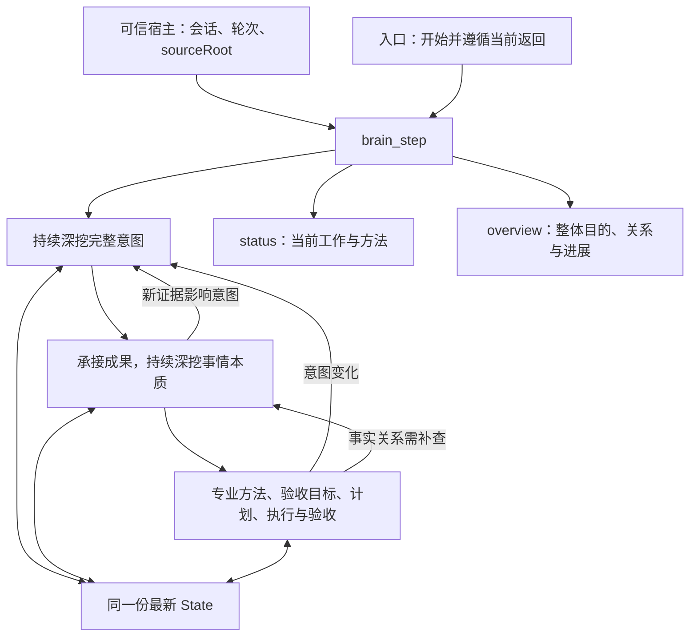

# 三阶段深度思考流程：模块定稿与整体检视

2026-10-27，用户在实际质量复核后明确要求：“那我们可以定稿了，代码stage一下。然后做个整体客观的检视”，随后澄清：“应该是跟其他brain_* tool一样的做法吧”。本次据此把受测实现接入既有公共工具清单和注册入口，并同步默认流程及现有插件。

## 目标与设计关系

根本依据是 [用户目的](base/01-origin-and-goal.md)、[设计取向](base/02-design-philosophy.md)、[事实—意图—表达模型及例子](base/04-fact-intent-expression-model.md)。目标是正确理解用户完整意图、追查决定结果的事实关系、主动取得专业方法，并据此计划、执行、验收和持续修正，减少用户重复说明与纠偏。

模型负责开放调查、语义判断和实际工作；程序负责阶段和任务 ID、原子请求、状态保存、机械检查及返回组装。`completion`核对成果；`workflow`只核对流程。程序记录模型的判断，不独立证明其语义正确。

## 正式文件与使用

| 对象 | 位置与职责 |
| --- | --- |
| 对外模块 | [`code/brain/step/index.mjs`](../../code/brain/step/index.mjs)，通过`brain/step`导出注册器、文件runtime与工具定义；公开类型为同目录`index.d.mts` |
| 状态转换 | `engine.mjs`，同一State承接三阶段、继续/回查、执行核对、完成与交接 |
| 持久化 | `file-runtime.mjs`，可信宿主选择会话文件，每次调用读取并原子保存 |
| 工具边界 | `schema.mjs`及`tool.mjs`，实际MCP schema、业务拒绝及纠正指导 |
| 当前与整体返回 | `views.mjs`，只从同一最新State组装当前指导或整体视图 |
| 审核后的文字 | `guidance/`，字段说明、三阶段方法、提交方式、待决处理及最终交付规则 |
| 模型入口 | [`think-workflow/brain-ai/index.md`](../../code/brain/think-workflow/brain-ai/index.md)，沿用默认路径，使用工具推进，遗忘用status，整体核对用overview |
| 注册示例与限制 | [`step/README.md`](../../code/brain/step/README.md) |

每个会话的State文件使用宿主会话ID的SHA256命名，位于当前sourceRoot的`.brain-working/brain-step-three-phase/`。新轮start清空旧工作状态；同轮重复start保留进展；阶段切换不清空或复制成果。State是会话工作材料，不是第三种Brain cognition scope。

## 本次定稿的实际变化

受测来源是`three-phase-candidate-quality-2026-10-27`。本次把其实现和有效文字纳入版本控制，消除对本机测试目录的运行依赖：Zod从包依赖导入；提交指导逐字提取成`submissions.json`，不再解析审核报告；`work.candidate.md`仅改为正式文件名`work.md`；入口去掉隔离验证专用命令适配段。代码正常格式化，模型指导文件排除自动格式化，并以限定路径的Git属性保留源文件换行，保持审核原文。

工具definition/input/output、三阶段方法、状态维护、网络调查默认及例外、Q1关键判断条件、Q2交付核对、Q3草稿修改使验收失效及T1合法重提均沿用受测版本。没有加入未加载验证的专业经验新增句，没有根据局部疑点重写提示词。

## 验证及其证明范围

本次没有启动模型、Codex CLI或LPC。已完成：

- 迁移等价核对：41个程序请求，成功/拒绝时的实际返回、状态及变更标识与受测实现一致；固定方法/指导及工具定义一致，入口正文仅去掉测试适配说明。
- 原有8组SDK/文件/stdio检查通过；追加8组质量契约检查通过。追加检查副本首次漏复制一个说明文件，补齐后遇到一次原子替换EPERM；保留两次失败记录，使用较短临时目录后全部通过。没有据此声称已证明EPERM的唯一原因，也没有修改受测保存规则。
- 正式代码新增5项真实SDK与磁盘测试：参数前置拒绝、同轮幂等与会话隔离/新轮重置、草稿变更失效、上游回查优先及原子失败保护。
- 另增公共注册入口测试，验证原生tools/list、可信宿主绑定、缺失身份时不改状态，以及同会话新轮重置。
- Brain全量`vp test`：17个文件、193项测试通过。变更代码的`vp check`及`vp run build`通过；模型指导保持原文。
- Codex/Claude插件验证通过，覆盖真实hook到MCP的会话/轮次绑定、两轮重置和已结束Claude绑定拒绝；DSH构建、typecheck及现有完整验证通过，包含原生metadata转发、会话隔离与新轮重置。
- 包管理器打包预检确认公开模块、类型、三阶段方法、工具定义、提交指导及默认入口均进入发布文件列表。

前次模型验证为Desktop `gpt-6-luna/high`、8会话16轮，A名单、B客服安排、C来访材料及D成套备料的主要本地结果有支持。没有发现明显影响主要目标达成的质量问题。C分类表预填参考答案留下发放/理解检查效力疑点，不据此判整个活动无效；B对外承诺由用户决定符合原始约定。

这些小型模拟任务不证明开放复杂场景持续挖到最深、长期用户认识学习、真实实施效果或新增提示词的独立增益。程序通过和模型提交passed分别保持其证明边界。

## 整体检视结论

1. **目的、三阶段方法与工具职责相互一致。** 意图先于事情本质；阶段1允许为查意图调查事实，后续事实反过来改变意图时回查，没有把调查事实一律推迟。第三阶段包含专业方法和实际工作，未来任务不冒充本轮完成。
2. **当前与整体读取分工明确。** 普通更新简短返回；进入新阶段或status提供当前方法；overview提供整体工作材料。未增加第二套整体State或历史步骤成果，保存不提升内容置信度。
3. **工具的拒绝、失效和交付有相应指导。** 格式拒绝先于宿主解析；业务拒绝不部分写入；真实草稿变化失效验收；回查优先于旧完成判断；handoff保留未完成。SDK与持久化测试覆盖机械行为，不能替代模型调查质量。
4. **正式注册和默认入口已接通。** `brain_step`进入公共清单及`registerBrainTools`，保留原input/output契约；默认brain-ai文件替换为已验证入口，没有维护两份相同流程。Codex使用会话绑定与真实hook轮次，缺少宿主turn_id时由该次hook建立轮次标识；DSH使用agent ID和真实用户splice序号；Claude使用宿主会话ID与hook轮次，SessionEnd删除结束会话的绑定。身份字段未进入模型业务参数，未把验证固定ID放入生产。
5. **宿主限制明确保留。** Claude官方说明MCP进程可能保留启动时的会话ID，部分恢复场景环境值也可能滞后；SessionEnd清理使旧绑定失败，无法取得当前身份时不猜测或扫描替代会话。旧宿主缺少会话环境变量、清空/恢复后继续复用旧MCP进程时，可能需要重新连接。该限制不影响其它cognition工具。依据：[Claude环境变量](https://code.claude.com/docs/en/env-vars)。每会话串行写入是当前State实现前提，未实现并发合并。
6. **没有发现本次迁移引入的核心语义缺陷。** 已通过原生SDK和插件程序检查；这不等同于已在用户当前运行中的插件进程加载，也不等同于新增真实模型端到端验证。MCP结构化结果附同对象JSON文本符合本次采用的[2025-11-25工具规范](https://modelcontextprotocol.io/specification/2025-11-25/server/tools#structured-content)，客户端最终呈现仍按实际宿主判断。

## 默认完整交付

三阶段工具与正式 brain-ai 方法记忆共同组成默认完整工作方式。宿主安装/更新从选定来源准备六份方法及 Global Core 入口，再接入宿主；CLI 维护者准备相同的数据环境，项目接入通过公开 cat 核验。实现与保守更新规则见 [Brain CLI](../../code/brain-cli/README.md)，实际项目核验见 [CLI 接入引导](../../code/brain-skill-toolkit-cli/INSTALL.md)。包就绪、宿主启用与真实模型效果分别验收，原有工具/模型测试仍只证明各自覆盖范围。

## 后续工作

本次完成源码定稿、原生接入及必要程序验收。用户当前运行中的宿主需要重新加载构建后的插件才能取得新工具；未自动重启用户应用，未创建commit或发布。若后续观察到实际质量或宿主兼容问题，按具体证据再讨论，不据未知增加提示词或模型用例。
